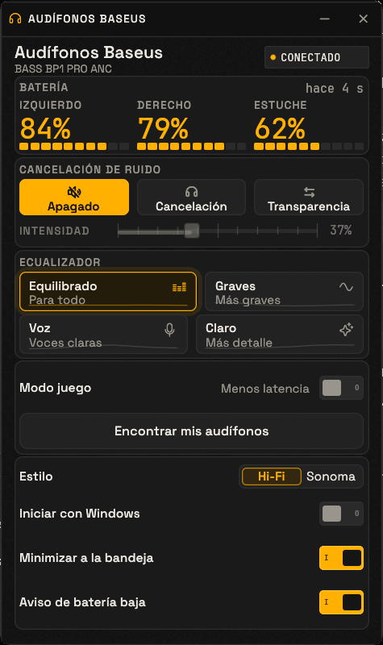
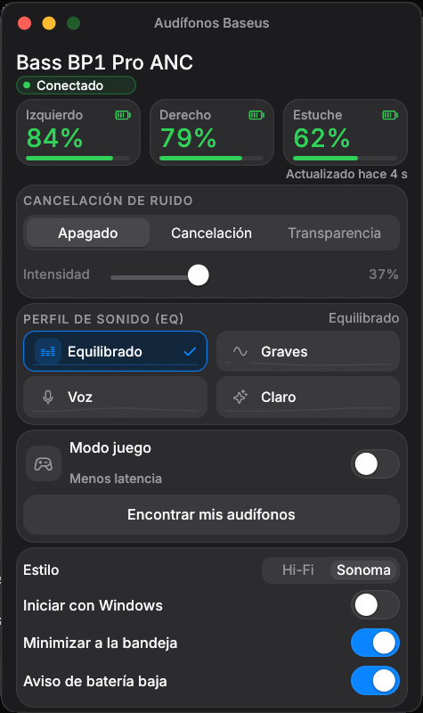

# Baseus Earphones

Desktop controller for **Baseus Bass BP1 Pro ANC** earphones. Pure Rust, single window, no browser, and no installer.

## Two Styles

The app includes two visual themes. You can toggle between them without restarting via **Settings > Style**:

**Hi-Fi Studio** (default): charcoal, amber, and technical typography.



**Sonoma**: desktop dark mode, rounded cards, system blue, and green battery indicator.



*Screenshots captured using the simulated device.*

## Features

- View battery levels for the left earphone, right earphone, and charging case (including case charging status).
- Toggle between Noise Cancellation, Off, and Transparency modes.
- Adjust noise cancellation intensity using a slider.
- Select from four EQ presets: Balanced, Bass, Vocal, and Clear.
- Enable Game Mode to reduce audio latency.
- Find your earphones by playing an 8-second tone.
- Launch with Windows, minimize to the system tray, and receive low battery notifications (<15%).
- Switch between Hi-Fi Studio and Sonoma visual styles.

The app automatically searches for the earphones on startup. If none are found, it provides a button to retry and another to open Windows Bluetooth settings.

## Usage

1. Pair your earphones once via **Settings > Bluetooth**.
2. Run `AudifonosBaseus.exe`. No installation required.
3. If you open a second instance, the existing window will be brought to the front.

Settings are saved at `%APPDATA%\AudifonosBaseus\settings.json`. Autostart with Windows is registered in the Windows Registry and can be toggled directly from the app settings or managed via Task Manager.

When **Minimize to tray** is enabled, clicking the Close (X) button hides the window instead of quitting the application. To fully exit, right-click the system tray icon and select **Exit**, or disable the option in settings.

## Status & Limitations

This project was built from scratch and **has not been tested with physical earphones**. The interface was validated using a simulated device, and the BLE packets were cross-referenced with the original reference project. If a feature does not respond with your physical device, please open an issue with your exact earphone model and details on what you observe.

- Compiled and tested on Windows 11 (25H2) using Rust 1.99 and the GNU toolchain.
- Supports **BP1 Pro ANC only**. Other Baseus models use different command protocols.
- Requires Bluetooth LE. If your system adapter does not support BLE, Windows will not detect the device.

## Battery Reading Troubleshooting

The app never guesses battery percentages: if an earphone is in the case, it displays **In case**. If the firmware sends an out-of-range byte (outside 0–100%), it displays **—** instead of rounding up to 100%. Initial values show **—** until the first telemetry payload arrives, accompanied by a timestamp label showing **X s ago**.

If a reading seems incorrect, run the executable with `--debug` (or set the environment variable `BASEUS_DEBUG=1`). This logs every notification and write operation to `%APPDATA%\AudifonosBaseus\debug.log` in hexadecimal format with UTC timestamps (automatically rotating at 512 KB). Attach this `debug.log` to your GitHub issue so the raw bytes sent by the firmware can be inspected. Without this flag, no log files are written.

## Windows SmartScreen Warning ("Windows protected your PC")

Because the executable is not digitally signed, Windows SmartScreen may show a warning upon first execution. The binary is either the one you built locally or the one generated by the GitHub Actions workflow.

1. Click **More info**.
2. Click **Run anyway**.

#Audífonos Baseus

Control de escritorio para los audífonos **Baseus Bass BP1 Pro ANC**. Rust puro,
una sola ventana, sin navegador ni instalador.

## Dos estilos

La app incluye dos aspectos y puedes cambiar entre ellos sin reiniciar, en
**Ajustes > Estilo**:

**Hi-Fi Studio** (el predeterminado): carbón, ámbar y tipografía técnica.


**Sonoma**: modo oscuro de escritorio, tarjetas redondeadas, azul de sistema y
batería en verde.


*Capturas tomadas con el dispositivo simulado.*

## Qué puedes hacer

- Ver la batería del audífono izquierdo, el derecho y el estuche, con el estado
  de carga del estuche.
- Cambiar entre Cancelación, Apagado y Transparencia.
- Ajustar la intensidad de la cancelación con un deslizador.
- Elegir entre cuatro ecualizaciones: Equilibrado, Graves, Voz y Claro.
- Activar el modo juego, que reduce la latencia.
- Encontrar los audífonos con un tono de 8 segundos.
- Arrancar con Windows, minimizar a la bandeja y recibir un aviso cuando la
  batería baja del 15%.
- Elegir el estilo Hi-Fi Studio o Sonoma.

La app busca los audífonos al abrirse. Si no los encuentra, muestra un botón
grande para buscar de nuevo y otro para abrir el Bluetooth de Windows.

## Cómo se usa

1. Empareja los audífonos una vez en Configuración > Bluetooth.
2. Abre `AudifonosBaseus.exe`. No hace falta instalarlo.
3. Si abres una segunda copia, la ventana que ya existe se trae al frente.

Los ajustes se guardan en `%APPDATA%\AudifonosBaseus\settings.json`. El arranque
con Windows se guarda en el registro y se puede quitar desde la misma app o
desde el Administrador de tareas.

Con **Minimizar a la bandeja** activado, la X oculta la ventana en vez de cerrar
la app. Para salir del todo, haz clic derecho en el icono de la bandeja y elige
**Salir**, o desactiva esa opción.

## Estado y límites

Este proyecto se escribió desde cero y **no se pudo probar con audífonos
físicos**. La interfaz se verificó con un dispositivo simulado y las tramas
están contrastadas con la tabla del proyecto original. Si algo no responde con
tus audífonos, abre un issue con el modelo y lo que ves.

- Compilado y probado en Windows 11 (25H2) con Rust 1.99 y el toolchain GNU.
- Solo se contempla el BP1 Pro ANC. Otros modelos Baseus usan otros comandos.
- Requiere Bluetooth LE. Si el adaptador no lo soporta, Windows no encontrará
  el dispositivo.

## Si la batería se ve mal

La app no inventa porcentajes: si un audífono está en el estuche muestra
**En estuche**, y si el firmware manda un byte fuera de 0–100 muestra **—** en
vez de redondearlo a 100 %. Los valores empiezan en **—** hasta que llega el
primer aviso del dispositivo, y junto a la batería aparece **hace X s** con la
hora del último dato.

Si un valor no cuadra, ejecuta el .exe con `--debug` (o define
`BASEUS_DEBUG=1`). Eso escribe cada notificación y cada escritura en
`%APPDATA%\AudifonosBaseus\debug.log`, en hexadecimal y con marca de tiempo
UTC, y rota el archivo al llegar a 512 KB. Adjunta ese `debug.log` en el issue:
ahí se ve el byte crudo que mandó el firmware. Sin ese flag no se escribe nada.

## Si Windows muestra «protegió su PC»

El .exe no está firmado digitalmente, así que SmartScreen puede avisar la primera
vez. El archivo es el que compilas tú o el que publica la acción de GitHub.

1. Haz clic en **Más información**.
2. Haz clic en **Ejecutar de todas formas**.

## Compilar

```
cargo build --release --no-default-features
```

Sale en `target/release/AudifonosBaseus.exe`. El binario listo para usar está en
`dist/AudifonosBaseus.exe`, con su SHA-256 en `dist/SHA256SUMS.txt`. Para
desarrollo, `cargo run` y `cargo run --features mock -- --mock` para arrancar sin
hardware. Añade `--debug` para guardar el tráfico BLE en
`%APPDATA%\AudifonosBaseus\debug.log`.

Comprobaciones:

```
cargo fmt --all -- --check
cargo clippy --workspace --all-targets -- -D warnings
cargo test --workspace --features audifonos-baseus/mock
```

En Windows con el toolchain MSVC no hace falta nada más. Con el toolchain GNU,
instala MinGW-w64 y pon `windres` en el `PATH` para que el icono y los metadatos
se incrusten en el exe.

## Publicar una versión

El flujo `.github/workflows/release.yml` se dispara con un tag que empiece por
`v`. Compila en `windows-latest`, genera `SHA256SUMS.txt` y publica el `.exe` y
el checksum en GitHub Releases:

```
git tag v1.2.3
git push --tags
```

## Cómo está hecho

- `crates/baseus-protocol`: tramas, comandos y decodificación, sin E/S.
- `crates/baseus-transport`: GATT de WinRT en un hilo propio con Tokio,
  reconexión con espera creciente.
- `app`: egui/eframe, tema oscuro pintado a mano, bandeja con
  `Shell_NotifyIconW`, instancia única y arranque automático.

## Rendimiento

Medido en Windows 11 con el binario de `dist/`:

- 6,2 MB el ejecutable, sin nada que instalar.
- Alrededor de 46 MB de memoria privada.
- Menos del 0,5 % de CPU con la ventana en reposo.

## Créditos

Este proyecto toma el protocolo documentado y las tramas de
[baseus-desktop](https://github.com/elaxptr/baseus-desktop), publicado bajo
licencia MIT, y las reescribe en Rust. La interfaz es propia.

- Rust y egui/eframe: MIT/Apache-2.0.
- Icono: dibujado con un script propio, `scripts/make-icon.py`.
- Tipografías **Space Grotesk** y **JetBrains Mono**, bajo SIL Open Font
  License 1.1. Las licencias están en `app/assets/fonts/OFL-*.txt`.
- Tipografía **Inter**, bajo SIL Open Font License 1.1. La licencia está en
  `app/assets/fonts/OFL-Inter.txt` y solo se incluye el subconjunto Latin.
- Iconos **Phosphor**, bajo licencia MIT. La licencia está en
  `app/assets/fonts/LICENSE-Phosphor.txt` y solo se incluye el subconjunto de
  glifos que usa la interfaz.

## Licencia

MIT. Consulta [LICENSE](LICENSE).
